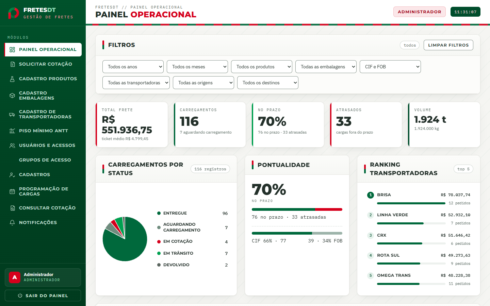
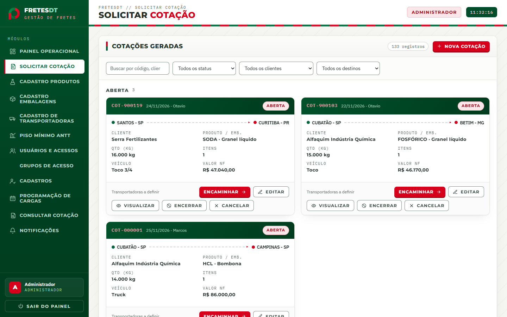
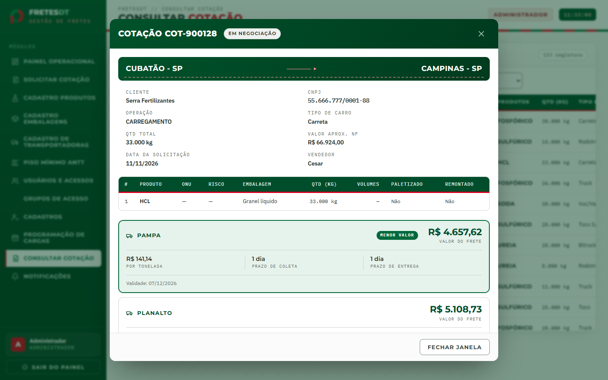
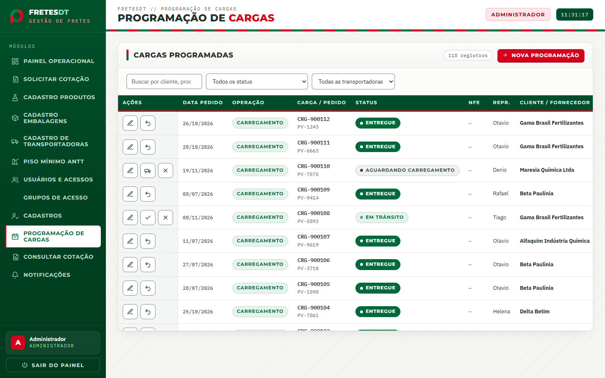
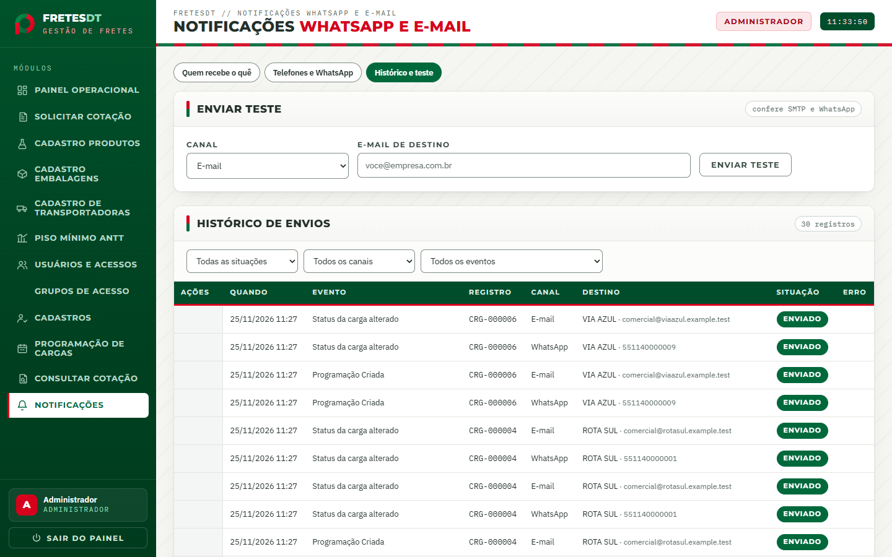
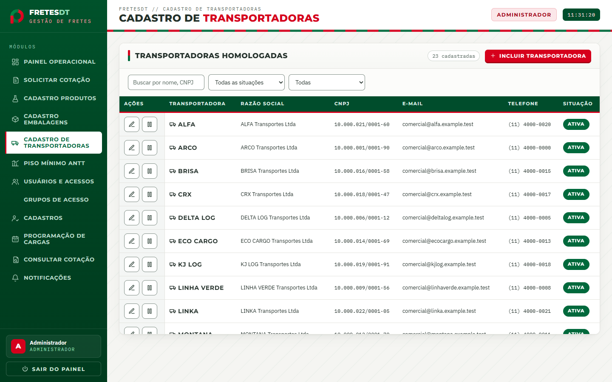
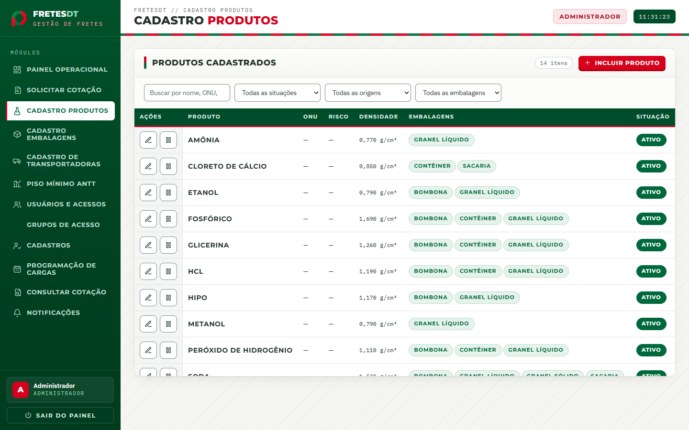
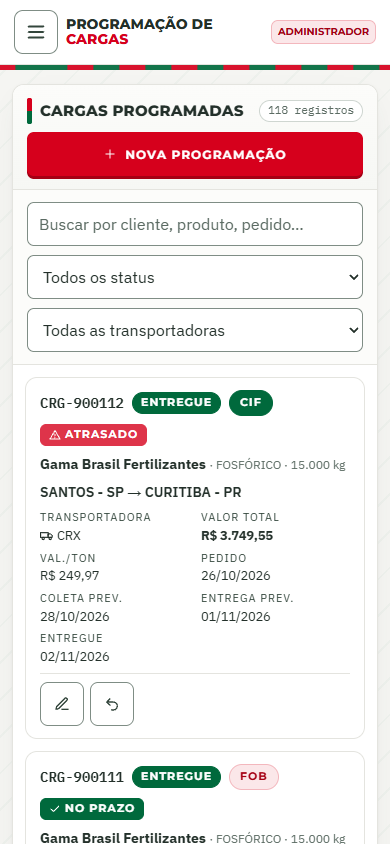
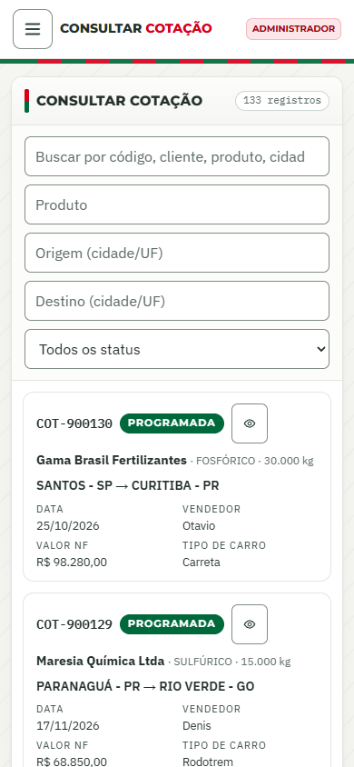

# FretesDT

Plataforma de gestão de fretes: o vendedor solicita a cotação, a operação encaminha a várias transportadoras, compara as respostas, fecha a negociação e acompanha a carga até a entrega. Back-end em Laravel, front-end em Vue 3.

> Código aberto para leitura e avaliação técnica. Todos os direitos reservados; não há licença de reuso.

## Apresentação



*Painel operacional: indicadores, pontualidade e ranking de transportadoras. Todos os dados exibidos são fictícios.*

### O fluxo em quatro passos

1. **Solicitar:** o vendedor cria a cotação com itens, rota e tipo de veículo.
2. **Comparar:** a operação encaminha às transportadoras e compara as respostas lado a lado, com o menor valor em destaque.
3. **Fechar:** a negociação é fechada com uma transportadora e vira uma programação de carga.
4. **Acompanhar:** a carga é acompanhada até a entrega, com prazo, status e notificações por e-mail e WhatsApp.

| | |
|---|---|
|  |  |
| **Solicitar cotação:** cotações agrupadas por status, com rota, produto e valor da NF. | **Respostas comparadas:** valor por tonelada, prazos e validade de cada transportadora. |
|  |  |
| **Programação de cargas:** status, pedido, transportadora e cliente. | **Notificações:** histórico de e-mail e WhatsApp, com envio de teste. |
|  |  |
| **Transportadoras homologadas:** CNPJ, contato e situação. | **Produtos:** densidade e embalagens permitidas. |

### No celular

A interface é responsiva: as listas viram cartões, e o menu vira uma gaveta.

<p>
  
  &nbsp;&nbsp;
  
</p>

## Funcionalidades

- **Cotação** de frete fracionado e granel, com itens, embalagens, rota (IBGE) e tipo de veículo.
- **Negociação multi-transportadora:** encaminhamento a várias transportadoras, resposta ou declínio de cada uma, fechamento, encerramento sem fechar, cancelamento e edição com controle de versão.
- **Reaproveitamento de cotações** anteriores da mesma rota, veículo e produto, respeitando a validade.
- **Programação de carga** com acompanhamento de status (aguardando, em trânsito, entregue).
- **Piso mínimo de frete (ANTT):** importação dos coeficientes e distâncias e comparação com o valor negociado.
- **Espelho do ERP** por API-ponte, com sincronização incremental e completa e um painel de pendências de cadastro.
- **Painel operacional:** filtros, indicadores, ranking de transportadoras e painel administrativo de análise e auditoria.
- **Perfis** de vendedor, gestor, administrador e transportadora, com grupos e permissões configuráveis e auto-cadastro com aprovação.
- **Notificações** por e-mail e WhatsApp: matriz de evento x canal x grupo, histórico, reenvio, teste, link direto para o registro e templates em pt-BR.
- Interface responsiva, com navegação por teclado e foco gerenciado em diálogos.

## Robustez técnica

- **Idempotência** na criação de cotações (`Idempotency-Key`) e nas notificações (chave determinística por evento, registro, destino e canal).
- **Concorrência:** bloqueio pessimista em sequências e sincronizações e controle de versão otimista nos registros editáveis.
- **Validação rigorosa de entrada:** respostas 422 padronizadas, validação de CNPJ, limites de valores e rejeição de filtros não escalares.
- **Autorização por perfil e escopo:** a transportadora só enxerga o que é seu, e o servidor é a fonte da verdade (o front apenas antecipa).
- **Rastreabilidade:** correlação por requisição, log de operações com estado antes e depois e trilha de auditoria.
- **Entrega resiliente:** e-mail com failover entre provedores, driver de WhatsApp plugável (log, nulo, API oficial ou Evolution), limite de envio por minuto e eventos disparados após o commit, sem derrubar a transação.
- **Autenticação** por JWT assinado (RS256) com refresh e limitação de tentativas.
- **Testes:** 545 testes PHPUnit no back (feature e unit) e 704 testes Vitest no front, mais uma suíte E2E com Playwright que sobe back, ponte de ERP simulada e front em ambiente descartável.

## Estrutura

| Pasta | Conteúdo |
|---|---|
| `BACK/` | API REST e painel administrativo (Laravel 13, PHP 8.3+) |
| `FRONT/` | Aplicação web (Vue 3, Vite, Tailwind 4) |
| `im-hub/` | Material de apresentação do projeto: capa, prints e documentos |
| `evolution/` | Compose opcional da Evolution API (WhatsApp) para ambiente local; copie `.env.example` para `.env` e preencha `AUTHENTICATION_API_KEY` e `POSTGRES_PASSWORD` (por exemplo com `openssl rand -hex 24`) |

## Documentação

- [API REST](docs/API.md): convenções e endpoints
- [Estrutura de dados](docs/DADOS.md): tabelas, relações e status
- [API x controller](docs/CONTROLLERS.md): endpoint, controller e ação
- [Contrato do ERP](docs/ERP.md): API-ponte e campos esperados
- [Comandos úteis](docs/COMANDOS.md): back, front, E2E e WhatsApp local

## Como rodar localmente

```bash
# back-end
cd BACK
composer install
cp .env.example .env              # defina FRETE_ADMIN_LOGIN, FRETE_ADMIN_SENHA e FRETE_DEV_SENHA
php artisan key:generate
php artisan frete:jwt-keys
# SQLite: DB_CONNECTION=sqlite e DB_DATABASE=database/dev.sqlite no .env
touch database/dev.sqlite
php artisan migrate:fresh --seed
php artisan serve --host=127.0.0.1 --port=8000

# front-end (outro terminal)
cd FRONT
npm install
npm run dev
```

Em ambientes que não são de produção, o seed também cria dados fictícios de demonstração (vendedores, transportadoras, clientes, cotações e cargas).

## Testes

```bash
cd BACK  && php artisan test
cd FRONT && npm test         # unitários
cd FRONT && npm run e2e      # ponta a ponta
```
