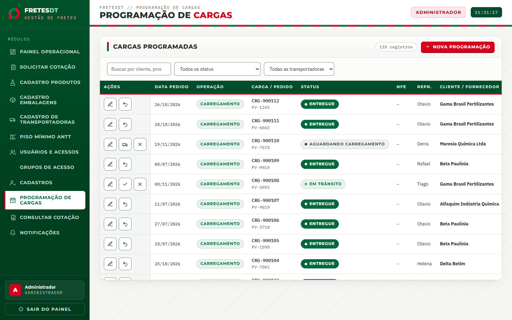
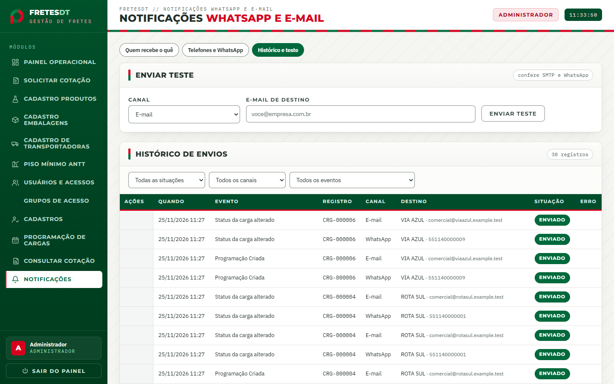

# Arquitetura

## Visão geral

Duas aplicações independentes, que conversam por uma API REST em JSON:

- **BACK:** Laravel 13 (PHP 8.3+). API REST em `/api` e um painel administrativo web em `/admin`.
- **FRONT:** Vue 3 com Vite e Tailwind 4, em página única. O Vite encaminha `/api` para o back em desenvolvimento.
- **Banco:** SQLite em desenvolvimento e nos testes; a aplicação também roda em MySQL. Todas as tabelas usam o prefixo `frete_`.
- **Fila:** driver `database` para o envio de notificações.
- **WhatsApp:** driver plugável (log, nulo, API oficial ou Evolution API), com a Evolution rodando em Docker.

## Fluxo principal

1. O vendedor cria a **cotação** (itens, rota, veículo, valor da nota).
2. A operação **encaminha** a cotação a uma ou mais transportadoras. Cada uma vira uma resposta em `negociacao_resposta`.
3. Cada transportadora **responde** (valor por tonelada, prazo de coleta e entrega, validade) ou **declina**. Uma transportadora não enxerga a concorrência.
4. A operação compara as respostas e **fecha** a negociação com uma delas, **encerra** sem fechar ou **cancela**.
5. A cotação fechada vira uma **programação de carga**, acompanhada até a entrega.
6. Cada passo gera eventos de notificação e registros de auditoria.

## Decisões

- **Autenticação:** JWT assinado com RS256 e refresh token rotativo, com detecção de reutilização. As permissões não vão dentro do token, são resolvidas no servidor a cada requisição.
- **Autorização por perfil e escopo:** cada rota exige uma permissão, e os registros são filtrados pelo perfil (por exemplo, a transportadora só vê o que é seu). Fora do escopo, o registro simplesmente não existe (404).
- **Concorrência:** controle de versão otimista (`versao`) nos registros editáveis e bloqueio pessimista nas sequências de código e nas sincronizações.
- **Idempotência:** `POST /cotacoes` aceita `Idempotency-Key`, e as notificações têm chave determinística por evento, registro, destino e canal.
- **Validação:** o servidor é a fonte da verdade. Erros voltam padronizados (422), e o front apenas antecipa as regras.
- **Rastreabilidade:** identificador de correlação por requisição, log de operações com estado antes e depois, trilha de acessos e log de sistema com retenção.
- **Notificações resilientes:** os eventos disparam depois do commit e não derrubam a transação. O e-mail tem failover entre provedores, e o WhatsApp tem limite de envio por minuto.
- **Integração com o ERP isolada:** o sistema nunca chama o ERP durante uma requisição de usuário. Um agendador espelha os cadastros pela API-ponte, e os registros com problema (CNPJ inválido, por exemplo) entram numa fila de revisão em vez de falhar a carga.

## Qualidade

- PHPUnit no back (feature e unit), Vitest no front e uma suíte E2E com Playwright que sobe back, ponte de ERP simulada e front em ambiente descartável.
- Documentação do repositório: API REST, estrutura de dados, relação endpoint por controller, contrato do ERP e comandos úteis.
