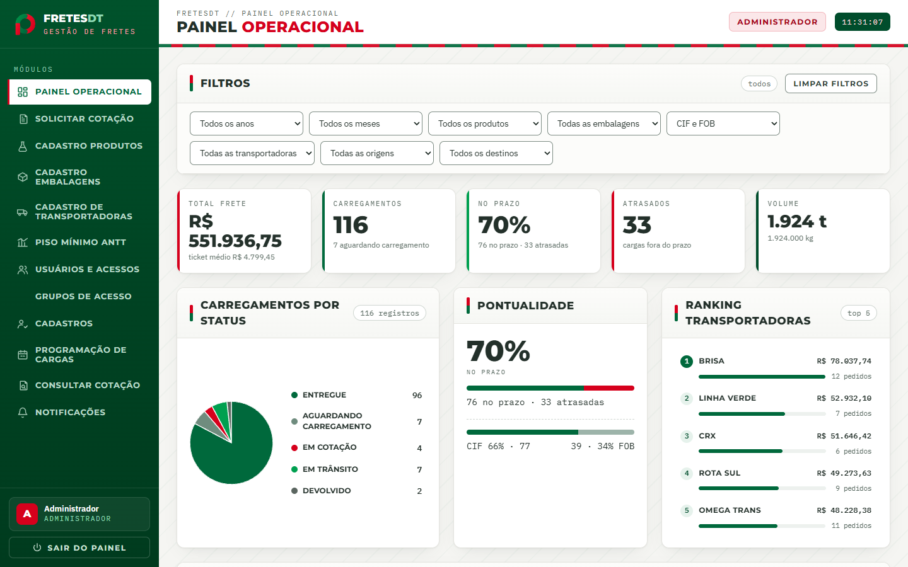
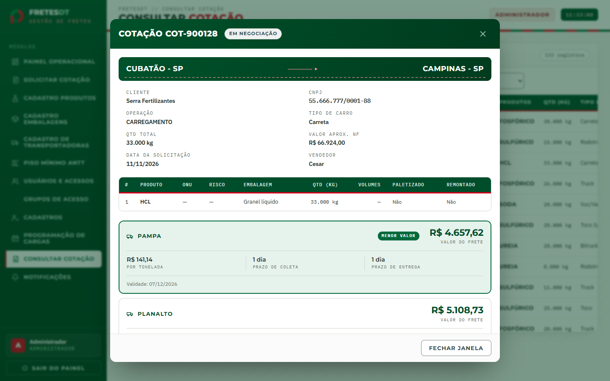

# FretesDT

Plataforma de gestão de fretes. O vendedor solicita a cotação, a operação encaminha o pedido a várias transportadoras, compara as respostas, fecha a negociação e acompanha a carga até a entrega.



## Problema

A cotação de frete costuma rodar por telefone, planilha e conversa avulsa. Fica difícil comparar o que cada transportadora respondeu, saber quem recebeu qual pedido, provar quem aprovou o quê e acompanhar a carga depois do fechamento. O FretesDT concentra esse fluxo num só lugar, com histórico e controle de acesso por perfil.

## O que foi construído

- **Cotação** de frete fracionado e a granel, com itens, embalagens, rota por município (IBGE) e tipo de veículo.
- **Negociação com várias transportadoras:** encaminhamento a quem a operação escolher, resposta ou declínio de cada uma, fechamento, encerramento sem fechar, cancelamento e edição com controle de versão.
- **Reaproveitamento** de cotação anterior da mesma rota, veículo e produto, dentro da validade.
- **Programação de cargas** com status (aguardando carregamento, em trânsito, entregue, devolvida) e indicador de prazo.
- **Piso mínimo de frete (ANTT):** importação de coeficientes e distâncias e comparação com o valor negociado.
- **Espelho do ERP** por uma API-ponte somente leitura, com sincronização incremental e painel de pendências de cadastro.
- **Perfis** de vendedor, gestor, administrador e transportadora, com grupos e permissões configuráveis e auto-cadastro com aprovação.
- **Notificações** por e-mail e WhatsApp, com matriz de evento por canal e grupo, histórico, reenvio e link direto para o registro.
- **Painel operacional** e painel administrativo de análise e auditoria.
- Interface responsiva, com navegação por teclado.



## Como rodar

Requisitos: PHP 8.3+, Composer, Node.js e npm.

```bash
cd BACK
composer install
cp .env.example .env
php artisan key:generate
php artisan frete:jwt-keys
touch database/dev.sqlite
php artisan migrate:fresh --seed
php artisan serve --host=127.0.0.1 --port=8000

cd ../FRONT
npm install
npm run dev
```

Antes do seed, defina no `.env` do back `FRETE_ADMIN_LOGIN`, `FRETE_ADMIN_SENHA` e `FRETE_DEV_SENHA`, com `DB_CONNECTION=sqlite` e `DB_DATABASE=database/dev.sqlite`. Testes: `php artisan test` no back, `npm test` e `npm run e2e` no front.

## Próximos passos

- Estabilizar a suíte E2E, que ainda tem especificações com falha conhecida e capturas de tela instáveis.
- Documentar o formato do CSV de coeficientes do piso ANTT.
